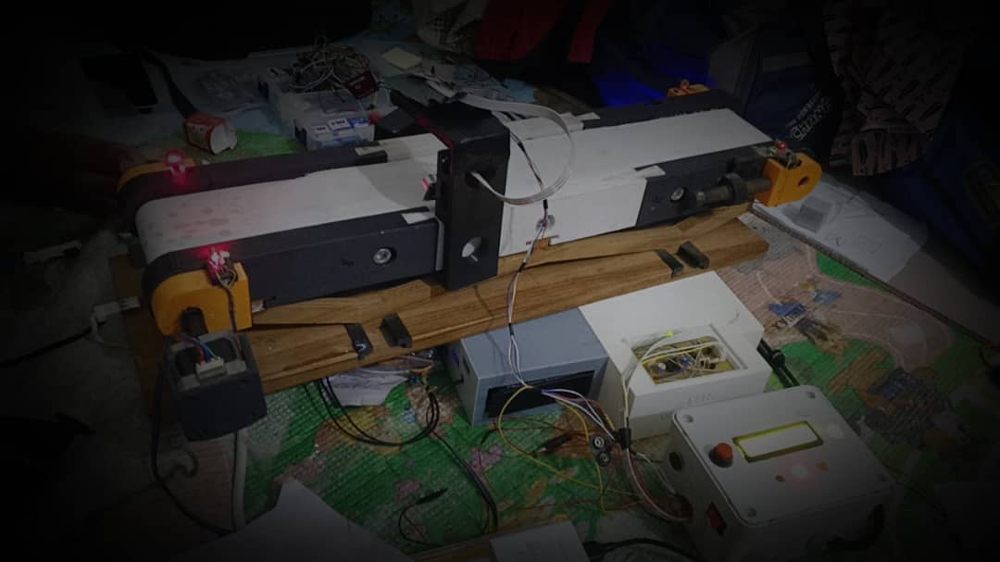
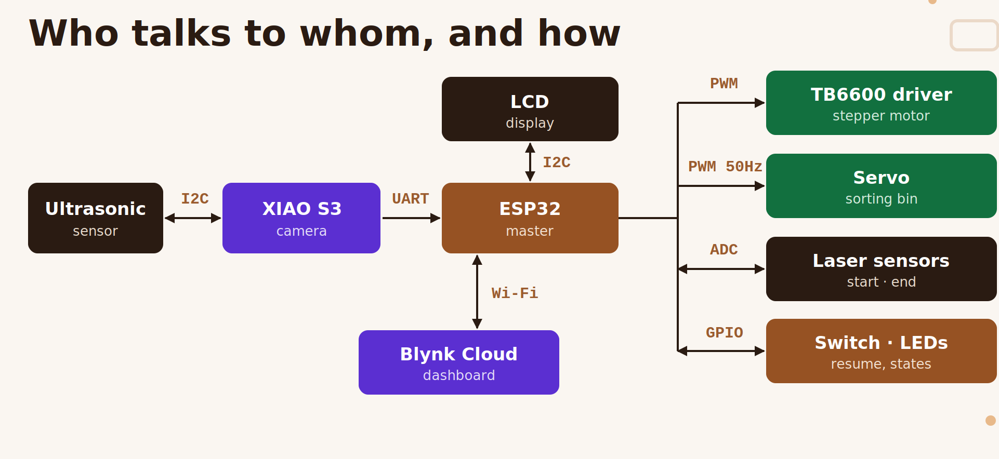

# Industrial Color Cube Sorter

**Automatic color sorting of cubes, monitored remotely in real time.**

A small-scale industrial sorting line built by the *Club d'Informatique Industrielle · IGE × EPAC* (École Polytechnique d'Abomey-Calavi).

Cubes ride a conveyor belt. A camera identifies each cube's color, a servo-driven bin swings to the right position, and every sort is counted and sent live to a Blynk dashboard. Unknown cubes and emergencies stop the belt safely.






---

## Table of contents

1. [Why this project](#why-this-project)
2. [Features](#features)
3. [How it works](#how-it-works)
4. [Hardware](#hardware)
5. [Wiring (ESP32 master)](#wiring-esp32-master)
6. [Software](#software)
7. [Getting started](#getting-started)
8. [Blynk dashboard](#blynk-dashboard)
9. [Camera protocol (UART)](#camera-protocol-uart)
10. [Safety](#safety)
11. [Configuration](#configuration)
12. [Testing](#testing)
13. [Repository layout](#repository-layout)
14. [Results](#results)
15. [Known limits and roadmap](#known-limits-and-roadmap)
16. [Credits](#credits)

---

## Why this project

Sorting by hand is slow, tiring, and error-prone. In factories, warehouses and recycling plants, thousands of parts must be separated every day, with irregular pace and no traceability. Some sorting jobs (lithium batteries and electronic waste, biomedical waste, radioactive waste) put people in real danger.

**Our challenge:** sort by color without human intervention, and follow production remotely.

## Features

- **Sorts** yellow, green and blue cubes by orienting a bin at the right moment.
- **Protects**: detects an unknown cube and stops the belt on the spot; emergency stop from a physical button or from the dashboard.
- **Supervises**: per-color counters, total, last sorted item, timestamped log and live chart on Blynk.
- **Stays reliable**: software debounce, inactivity watchdog, and resume after a stop without losing the count (counters survive a reboot).
- **Never blocks**: no `delay()` in the sorting logic, and Wi-Fi runs in its own task on the second core, so a bad network cannot freeze the belt.

## How it works

| # | Step | What happens |
|---|------|--------------|
| 1 | Detection | The start laser spots a cube: it enters the queue and the belt starts. |
| 2 | Identification | The ultrasonic sensor sees it, the camera captures it, HSV gives the color, sent over UART. |
| 3 | Transport | The belt moves at constant speed; each cube keeps its own state. |
| 4 | End of belt | The end laser detects the arrival and the servo orients the bin. |
| 5 | Drop | After a computed delay (distance ÷ speed) the cube falls into the right bin. |
| 6 | Counting | Counters, last sort and chart are updated on Blynk. |

**Drop delay.** With the default settings (24 rpm, 10 cm roller perimeter, 5 cm end-sensor-to-bin distance):

```
step frequency  f = rpm × 200 × microstep / 60       = 80 Hz
belt speed      v = rpm / 60 × perimeter             = 4 cm/s
drop delay      T = distance / v                     = 1250 ms
```

Cubes must be at least 5 cm apart so the bin has time to move before the next cube drops.

## Hardware

| Part | Role |
|------|------|
| ESP32 (master) | Reads the sensors, drives belt and bin, shows status, talks to the cloud |
| XIAO ESP32-S3 Sense | Camera: color detection (HSV), sends the result to the ESP32 over UART |
| Ultrasonic sensor | Sees the cube in front of the camera (I2C, via the XIAO) |
| NEMA 17 stepper + TB6600 driver | Belt motor, single direction |
| SG90 servo (180°) | Orients the sorting bin |
| 2 × laser module (HW-493) + LDR | Start and end light barriers |
| LCD 16×2 (I2C, address `0x27`) | Local status display |
| 3 LEDs (green, yellow, red) | Running / stopped / alert |
| Toggle switch | Resume after an emergency stop |
| External 5 V supply (servo) | Common ground with the microcontroller |

The full electrical sizing (comparators, optocouplers, transistor stages, LED resistors, driver settings) is in the **electrical study** (see [docs](#repository-layout)).

## Wiring (ESP32 master)

| Component | GPIO | Notes |
|-----------|------|-------|
| TB6600 `PUL` | 5 | Step pulses from the hardware PWM (LEDC) |
| TB6600 `ENA` | 2 | Active level `LOW` (GPIO2 is a strapping pin) |
| TB6600 `DIR` | not driven | Wired directly to supply: one direction only |
| Servo signal | 23 | 50 Hz PWM, 14 bits |
| Start laser sensor | 33 | Analog input, ADC1 |
| End laser sensor | 32 | Analog input, ADC1 |
| Green / yellow / red LED | 27 / 26 / 14 | |
| Resume toggle switch | 12 | `INPUT_PULLUP`, other side to GND |
| LCD SDA / SCL | 21 / 22 | I2C |
| Camera UART RX / TX | 16 / 17 | RX ← XIAO TX (TX unused) |

> The two analog sensors use ADC1 on purpose: on the ESP32, ADC2 cannot be used while Wi-Fi is on.

## Software

The firmware is a single Arduino sketch (`ESP32_master.ino`) organised in ten logical modules:

1. Configuration and parameters
2. Laser sensor acquisition (rising edge + debounce)
3. Cube queue (FIFO) and color assignment
4. Camera UART reception
5. Belt motor control
6. Bin orientation (servo)
7. Safety (emergency stop, resume, unknown cube, watchdog)
8. Signalling (LEDs and LCD)
9. Blynk supervision (separate task on core 0)
10. Counters, persistent memory and reset

**Key design ideas**

- **Time without blocking**: every delay is `millis() - t0`, never `delay()`.
- **Edges, not levels**: a cube is counted on the rising edge of a sensor, with a debounce window.
- **FIFO queue**: a fixed circular array of 10 cubes, each with color and state.
- **Two cores**: `loop()` (core 1) does the sorting; the Blynk task (core 0) exchanges data through a message queue and `volatile` flags.
- **Frozen timers during a pause**: on resume, every stored timestamp is shifted by the pause duration, so the drop delays are unaffected.
- **Safe by default**: a cube whose color is unknown (`X`, or never received) stops the belt instead of being sorted into the wrong bin.

A detailed explanation of each logic, with the calculations, is in the **software study** (see [docs](#repository-layout)).

**Requirements**

- Arduino IDE (or Arduino CLI) with the **Arduino-ESP32 core 3.x** (the sketch uses `ledcAttachChannel`)
- Libraries: **Blynk** and **LiquidCrystal_I2C**
- A Blynk template with the datastreams listed [below](#blynk-dashboard)

## Getting started

1. **Clone** the repository and open `ESP32_master.ino`.
2. **Install** the ESP32 core (3.x) and the two libraries above.
3. **Set your credentials** at the top of the sketch:
   ```cpp
   #define BLYNK_TEMPLATE_ID   "..."
   #define BLYNK_TEMPLATE_NAME "..."
   #define BLYNK_AUTH_TOKEN    "..."
   const char* WIFI_SSID = "...";
   const char* WIFI_PASS = "...";
   ```
4. **Calibrate the sensors** with `01_laser_ldr_detection.ino`: read the value with the beam received (about 4095) and with a cube blocking it (about 76), then adjust `DETECTION_THRESHOLD` (default 2000).
5. **Check the belt** with `02_stepper_tb6600.ino` (wiring and speed).
6. **Check the cloud link** with `03_blynk_communication.ino`.
7. **Upload** `ESP32_master.ino`, open the serial monitor at **115200** baud, and start the line.

You can run the whole sorting logic **without the camera**: with `KEYBOARD_SIMULATION = true`, type `J`, `V`, `B`, `X` or `A` in the serial monitor.

## Blynk dashboard

| Pin | Direction | Widget | Meaning |
|-----|-----------|--------|---------|
| V0 | ESP32 → cloud | Last sorted | Last color sorted (YELLOW / GREEN / BLUE / UNKNOWN) |
| V1 | ESP32 → cloud | Total | Total cubes sorted |
| V2 / V3 / V4 | ESP32 → cloud | LEDs Run / Pause / Alert | Virtual copies of the state LEDs |
| V5 / V6 / V7 / V8 | ESP32 → cloud | Counters | Yellow / green / blue / unknown |
| V10 | both | Play / Pause | `0` = emergency stop, `1` = resume |
| V11 | ESP32 → cloud | Graph | Total sorted over time |
| V12 | ESP32 → cloud | Terminal "Logs" | Timestamped event log (typed input is ignored) |
| V13 | both | "Reset DB" switch | Arms the counter reset |
| V15 | both | Bin selection | Follows the real bin; a manual choice moves the servo (not allowed while paused) |
| V16 | both | "Confirmation Code" | Code to confirm the reset |

**Resetting the counters needs two steps:** turn "Reset DB" **on**, then type the code (`RESET_CODE`, default `EPAC`) in "Confirmation Code". A wrong code cancels the reset.


## Camera protocol (UART)

The XIAO sends **one character per message**, at **9600 baud, 8N1**, on its TX pin to the ESP32 RX (GPIO16).

| Byte | Meaning | Effect |
|------|---------|--------|
| `J` | Yellow (*Jaune*) | Assigned to the oldest cube without a color |
| `V` | Green (*Vert*) | same |
| `B` | Blue (*Bleu*) | same |
| `X` | Unknown | same, plus 3 alert blinks; the belt stops when this cube reaches the end |
| `A` | Emergency stop | Immediate pause |
| anything else | n/a | Ignored |

The letters come from the French color names and are kept as-is so the camera firmware does not need to change.

## Safety

| Safety | Trigger | What happens | How to leave it |
|--------|---------|--------------|-----------------|
| Emergency stop | `A` from the camera button, Pause on the dashboard, `A` on the keyboard | Motor cut, everything ignored, red LED blinks | Flip the toggle switch (any change of position), or press Play |
| Unknown cube | Color `X` or `?` reaches the end sensor | Belt stops on the spot, red LED blinks | Remove the cube by hand; the belt resumes on its own |
| Watchdog | 120 s without any activity while the belt runs | Stop, bin back to center, queue cleared | A new cube at the start sensor |
| Debounce | Noisy sensors and switch | False edges ignored | n/a |

## Configuration

Everything adjustable is a constant near the top of the sketch. The main ones:

| Constant | Default | Meaning |
|----------|---------|---------|
| `rpm` | 24 | Roller speed |
| `ROLLER_PERIMETER_CM` | 10 | Roller perimeter (measure yours) |
| `END_TO_BIN_DISTANCE_CM` | 5 | End sensor to bin distance, also the minimum spacing between cubes |
| `ANGLE_J` / `ANGLE_B` / `ANGLE_V` | 0 / 90 / 180 | Servo angle per color |
| `DETECTION_THRESHOLD` | 2000 | Sensor threshold (out of 4095) |
| `DEBOUNCE_START_MS` / `DEBOUNCE_END_MS` | 600 / 300 | Sensor debounce; keep it below spacing ÷ speed (1250 ms at default) |
| `INACTIVITY_TIMEOUT_MS` | 120000 | Watchdog delay |
| `KEYBOARD_SIMULATION` | `true` | Type colors in the serial monitor |
| `DEBUG_RAW_UART` | `true` | Log every byte from the camera |

> Turn `KEYBOARD_SIMULATION` and `DEBUG_RAW_UART` off for real operation.

If you change the speed, remember the drop delay is inversely proportional to it: at 48 rpm it falls to 625 ms, and the 600 ms start debounce becomes almost too long.

## Testing

| Sketch | What it tests |
|--------|---------------|
| `01_laser_ldr_detection.ino` | Laser and LDR analog readings, to pick the threshold |
| `02_stepper_tb6600.ino` | Stepper motor through the TB6600 driver |
| `03_blynk_communication.ino` | Both directions of the dashboard link; serial commands `J V B X` (simulated sort), `R` (reset), `S` (status) |
| `ESP32_master.ino` | Full system; keyboard simulation, raw UART log, status line every 5 s |

Suggested order: sensors → motor → Blynk → full system without camera → full system with camera.

## Repository layout

```
.
├── ESP32_master.ino              # main firmware (ESP32 master)
├── tests/
│   ├── 01_laser_ldr_detection.ino
│   ├── 02_stepper_tb6600.ino
│   └── 03_blynk_communication.ino
├── docs/
│   ├── who_talks_to_whom.png     # architecture diagram
│   ├── electrical_study.pdf      # electrical study (sizing and components)
│   ├── software_study.pdf        # software study (logic behind the code)
│   └── slides.pdf                # project presentation
└── README.md
```


## Results


## Known limits and roadmap

**Known limits**

- Two cubes closer than the minimum spacing can reach the bin before it is oriented; the firmware logs it but cannot fix it.
- A manual bin choice from the dashboard is only refused during a pause, so it can misdirect a cube that is falling.
- The servo has no position feedback.
- The watchdog clears the queue but does not count cubes still on the belt.
- Counters are written to flash on every sort (4 values per cube); keep an eye on wear for long continuous use.
- Wi-Fi credentials and the Blynk token are written in the source file.

**What we hit and how we solved it**

| Difficulty | Solution |
|------------|----------|
| Wires coming loose | Hot glue on connections, fixed and checked wiring |
| Ambient light disturbing the lasers | Stable lighting, calibration in every new place |
| False triggers | Software debounce and rising-edge detection |
| Cubes too close, two in one image | Minimum spacing of 5 cm |
| Unstable Wi-Fi | Sorting continues offline, automatic reconnection, counters kept in memory |
| Limited camera (about 2 MP, no autofocus) | Simple HSV vision, centered cube |

**Roadmap**

- **Vision**: better camera, controlled lighting, shape sorting with OpenCV
- **Capacity**: more colors, faster belt, several bins
- **Data**: hosted web dashboard and a cloud database (for example Firebase) for a long history beyond Blynk

## Credits

Club d'Informatique Industrielle · **IGE × EPAC**, École Polytechnique d'Abomey-Calavi.
Supervisor: **Kevin HOUNSA**.

Built with Arduino-ESP32, Blynk, and a lot of hot glue.
